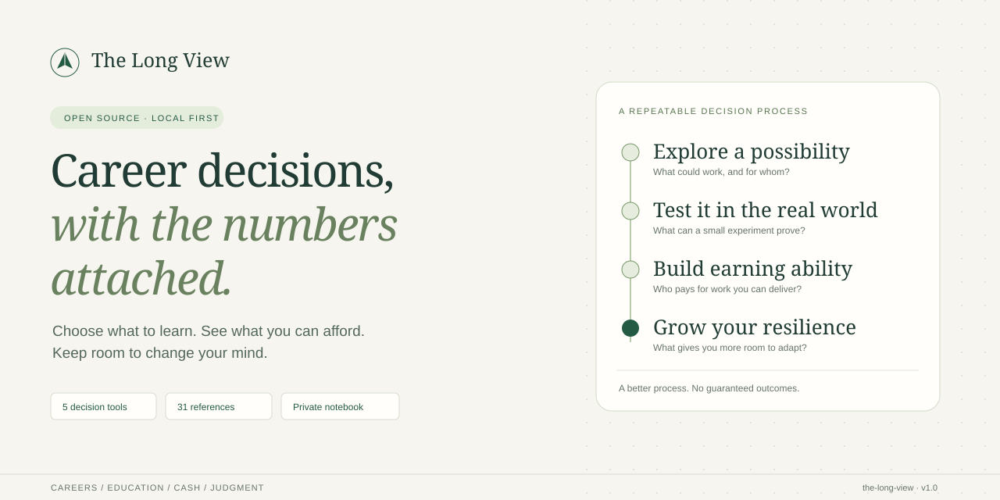

<p align="center">
  
</p>

# The Long View

**Career decisions, with the numbers attached.**

[](https://github.com/MJmuhammadjihad/the-long-view/actions/workflows/checks.yml) · [MIT license](LICENSE) · [v1.0.0 release](https://github.com/MJmuhammadjihad/the-long-view/releases/tag/v1.0.0)

An open, local-first guide for choosing a learning path, pricing a degree, protecting your cash runway, and thinking clearly about long-term wealth. Read the reasoning, change the assumptions, and keep a record of what changed your mind.

**[Open the toolkit](https://mjmuhammadjihad.github.io/the-long-view/)** · [Download the standalone HTML](https://github.com/MJmuhammadjihad/the-long-view/releases/latest/download/the-long-view.html) · [Contribute](CONTRIBUTING.md) · [Research approach](docs/RESEARCH.md)

> The guide combines general decision principles with dated Bangladesh hiring and payment examples. Calculators show consequences of your assumptions; they do not predict earnings or investment returns.

## What you can do

| Decision | Tool or guide |
| --- | --- |
| Which earning route should I try? | A 14-day comparison of development, QA/support, and feasible bridge income |
| Can I afford to finish my degree? | Remaining-cost and hypothetical payback calculator, with alternatives to compare |
| Does my weekly plan fit? | Capacity calculator that counts study, paid work, travel, care, and applications |
| What if income starts late? | Six-month cash scenarios, tuition bills, and the first projected funding shortfall |
| How do I build a financial base? | Household surplus/reserve planner and long-term savings sensitivity calculator |
| How will I avoid rewriting history? | Decision journal, checklist, text export, and restorable JSON backup |

The guide has **12 chapters**, **31 research and learning references**, and a **24-week plan with evidence gates**. Sources distinguish findings, forecasts, employer advertisements, and practical judgment. A target salary is never treated as guaranteed income.

## Try it in ten minutes

1. Open **Choose your route** and pick one representative task to test.
2. Use **Cash & investments** to compare a no-income case with your hoped-for outcome.
3. Record one decision, its assumptions, and what would change your mind in **Your decision journal**.

You can read every chapter without JavaScript. Enable it for navigation, calculators, search, and saved notes. Use the guide’s **Download HTML** button for a standalone copy, or **Print guide** for a printable version. External source pages need an internet connection.

## Run locally

Python 3 builds the guide. Node.js 22 or newer runs the development checks. There are no runtime package dependencies.

```sh
python3 build.py
python3 -m http.server 8000 --directory dist
```

Open <http://localhost:8000>. You can also open `dist/guide.html` directly; browser rules for local-file storage vary, so export notes you want to keep.

Development checks use Node.js and the committed package lock:

```sh
npm ci
npm test
```

The build produces a self-contained HTML guide with embedded styles and scripts. No external fonts, JavaScript libraries, or analytics are required by the application.

## Your data stays with you

Journal entries and checklist progress use your browser’s local storage. Calculator inputs are not saved. The application has no account system, journal backend, or telemetry; the hosting provider may still process ordinary access logs.

Shared browser profiles can expose saved notes. Clearing browser data, private browsing, or changing devices can lose or separate them. Export a JSON backup before moving your work. Restoring a backup requires confirmation before replacing current entries. Avoid putting personal financial details into public issues or screenshots.

## Help make the next decision better

Useful contributions include a stale-source correction, a reproducible calculator edge case, a keyboard or mobile usability fix, or a carefully sourced regional example. Start with [the contribution guide](CONTRIBUTING.md) and [the roadmap](docs/ROADMAP.md).

If this helps you, a star makes it easier to find again. A concrete report about what helped—or what was misleading—helps improve the project even more.

## Scope and provenance

This is an educational decision aid, developed with AI assistance. The research is a targeted synthesis, not a systematic review, a representative salary survey, or individualized financial advice. Source dates and limitations matter; verify eligibility, law, prices, and product terms before acting. No career, credential, or asset can guarantee security.

Original code and original guide content are available under the [MIT License](LICENSE). Linked research, trademarks, and other third-party material retain their own rights. See [research and attribution notes](docs/RESEARCH.md).
